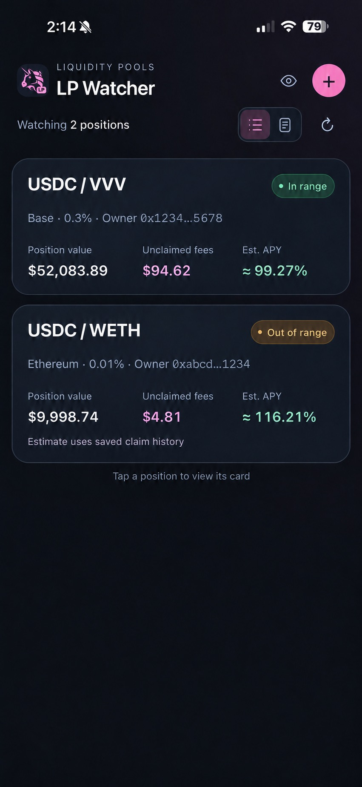
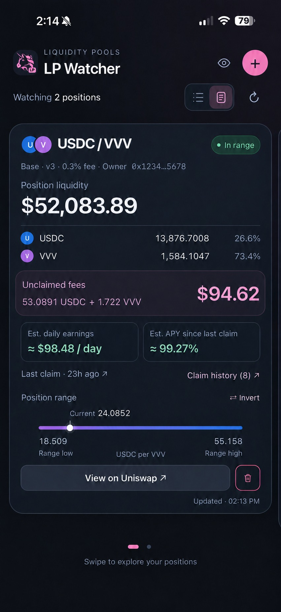

# LP Monitor

Monitor your Uniswap liquidity positions in one simple view.

**[Open LP Monitor](https://tonygallippi.github.io/uniswap-lp-monitor/)**

## Screenshots

  
  

*Illustrative screenshots with scaled example balances.*

## Get started

1. Open the app and tap **Get started**.
2. Tap **+** and paste a Uniswap v3 position URL.
3. Add more positions and swipe left or right to move between them.

Supported networks: **Base, Ethereum, Arbitrum, Optimism and Polygon**. Uniswap v4 positions are not currently supported.

No wallet connection, account, API key or signature is required.

## Install on your iPhone

Open the app in **Safari**, tap **Share → Add to Home Screen**, enable **Open as Web App** if shown, then tap **Add**.

Launch it from the new Home Screen icon for the full app experience.

## Your position card

- **Deposited liquidity:** current USD value, token quantities and each token’s percentage share.
- **Unclaimed fees:** fees available to collect, shown in USD and token amounts.
- **Daily earnings and APY:** estimates based on accrued fees and recorded claim history.
- **Last claim and claim history:** dated collections with transaction links, daily estimates and calculation details.
- **Position range:** low and high prices, with a white dot marking the current price.
- **In range / Out of range:** whether the position is within its active liquidity range.

Tap **View on Uniswap** to open the position there. LP Monitor does not claim fees, reinvest funds or submit transactions.

## Refresh and manage positions

Pull down from the top or tap **↻** to refresh. The app also checks for updates approximately every minute while open.

Use **+** to watch another position. Tap the **trash icon** on a card to stop watching it; this does not close your Uniswap position.

## Privacy and saved data

Tap the **eye icon** to hide balances, token quantities and earnings amounts. Position percentages, range prices and APY percentages remain visible.

Your watchlist, history snapshots and preferences are saved only in the browser or app on your device. They do not sync between devices, browsers or website addresses. Clearing browser data or removing the installed app may remove your watchlist.

Live reads go directly to public blockchain, explorer and price providers. Those providers receive the public identifiers needed for each request and may retain operational logs.

## Understanding earnings estimates

Estimated daily earnings equal the current unclaimed fee value divided by the days since the latest recorded claim. Estimated APY assumes that daily amount is reinvested against the current deposited-liquidity value for a year.

Thirty-day estimates spread collected fees across the intervals between claims and show the available history coverage. Partial days are identified in the daily estimates.

These calculations use current token prices and assume full claims and constant principal. Deposits, withdrawals, partial claims and changing prices can affect accuracy. Gas costs are excluded. Estimates are not guaranteed future returns, and this app does not automatically compound fees.

When collected amounts may include withdrawn principal, earnings estimates are withheld.

## If something is unavailable

- **Stale amounts:** check your connection, then pull down to refresh.
- **Saved snapshot:** the latest live read failed; the card shows previously saved data.
- **Claim history or APY unavailable:** public data providers may be rate-limited, blocked or incomplete. Unavailable does not mean zero claims or zero earnings.
- **Empty watchlist on another device or address:** add your position links again; saved data does not transfer automatically.
- **Older screen after an update:** close and reopen the app.

Live updates require internet access. Previously cached app files and saved position snapshots may remain available offline.

---

LP Monitor is an independent monitoring tool and is **not affiliated with Uniswap.org or Uniswap Labs**. See [artwork attribution](THIRD_PARTY_NOTICES.md).
